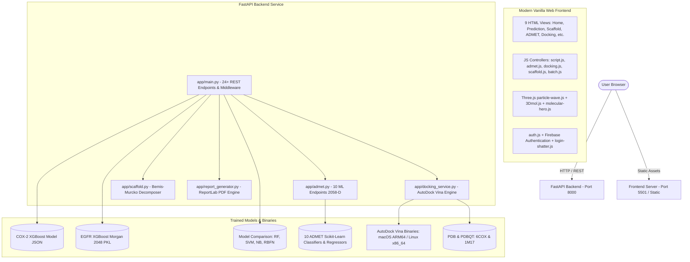

# BAMI (Bioactive Molecule Intelligence) — Complete Codebase Architecture & Source Code Explanation Guide

---

## 1. Executive Project Overview

**BAMI (Bioactive Molecule Intelligence)** is a full-stack, state-of-the-art computational chemistry and drug discovery web platform. It integrates:
1. **Machine Learning Bioactivity Prediction**: Real-time bioactivity classification against two major cancer and inflammation targets:
   - **COX-2 (Cyclooxygenase-2 / PTGS2)**: Modeled using 6 Lipinski/physicochemical descriptors evaluated across 5 machine learning algorithms (XGBoost, Random Forest, Linear SVM, Naive Bayes, Radial Basis Function Network).
   - **EGFR (Epidermal Growth Factor Receptor / P00533)**: Modeled using 2048-bit Morgan Circular Fingerprints (ECFP4 equivalent) with radius 2 and chirality.
2. **AutoDock Vina Molecular Docking Simulation**: Fully automated structure-based virtual screening with 3D ligand conformation generation (RDKit ETKDGv3), MMFF energy minimization, Gasteiger partial charge assignment, PDBQT rotatable torsion preparation, rigid protein pocket docking, and interactive 3D WebGL visualization via 3Dmol.js.
3. **10-Endpoint ADMET Profiling**: Absorption, Distribution, Metabolism, Excretion, and Toxicity prediction across 10 peer-reviewed benchmark datasets (ESOL, Caco-2, HIA, BBBP, CYP3A4, CYP2D6, CYP2C9, Ames Mutagenicity, DILI, and hERG cardiotoxicity) using 2058-dimensional feature vectors.
4. **Bemis-Murcko Scaffold & SAR Analysis**: Automated extraction of core ring assemblies, peripheral substituent (R-group) enumeration, Murcko framework canonicalization, chemical similarity clustering, and SAR bioactivity correlation.
5. **Drug-Likeness & Descriptors Filter**: Evaluation of Lipinski's Rule of Five, Veber rules, Ghose filter, and Egan bioavailability rules.
6. **Publication-Grade PDF Reporting**: Automated generation of multi-page scientific dossiers using ReportLab, RDKit SVG-to-vector embedding, and 2-pass running headers/footers.
7. **Interactive Visual Experience**: Custom Three.js micro-particle WebGL background with 3D camera parallax and kinetic ripple elevation, 60fps HTML5 canvas molecular shatter login portal with Web Audio API sound synthesis, and interactive 3D hero molecule with drag-to-spin physics.

---

## 2. High-Level Architecture & Data Flow



---

## 3. Directory Structure & File Inventory

```
XGBioactiveNew/
├── Backend/
│   ├── app/
│   │   ├── admet.py                 # 10-endpoint ADMET prediction engine (803 lines)
│   │   ├── docking_service.py       # AutoDock Vina molecular docking runner (692 lines)
│   │   ├── main.py                  # Core FastAPI REST application & routing (2,372 lines)
│   │   ├── report_generator.py      # Publication-grade PDF report engine (724 lines)
│   │   ├── scaffold.py              # Bemis-Murcko scaffold extraction & SAR (622 lines)
│   │   └── models/
│   │       ├── admet/               # 10 trained joblib models + admet_metrics.json
│   │       ├── comparison/          # Joblib models for RF, SVM, NB, RBFN
│   │       ├── compare_models.py    # Training & cross-validation script for comparison
│   │       ├── rbf_network.py       # Custom Scikit-Learn RBF Network implementation
│   │       └── xgb_cox2_model.json  # Production XGBoost COX-2 classifier
│   ├── bin/
│   │   ├── vina                     # Generic symlink / fallback
│   │   ├── vina_linux_x86_64        # AutoDock Vina binary for Linux (Render cloud)
│   │   └── vina_mac_arm64           # AutoDock Vina binary for macOS Apple Silicon
│   ├── data/
│   │   ├── receptors/               # Crystal structures: 6COX.pdb/pdbqt, 1M17.pdb/pdbqt
│   │   └── docking_runs/            # Ephemeral workspace for docking jobs
│   ├── result/                      # Model benchmark metrics CSVs and ROC curves
│   ├── tests/                       # 34 automated pytest test cases
│   └── requirements.txt             # Backend Python dependencies
├── EGFR_model_artifacts/            # EGFR Morgan fingerprint models, metadata, and curves
├── Frontend/
│   ├── index.html                   # Single & batch prediction page
│   ├── home.html                    # Beginner-friendly platform guide & dictionary
│   ├── scaffold-analysis.html       # Bemis-Murcko core scaffold exploration
│   ├── admet.html                   # Comprehensive 10-endpoint ADMET profiling
│   ├── docking.html                 # Molecular docking simulation with 3Dmol.js
│   ├── drug-likeness.html           # Lipinski, Veber, Ghose, and Egan filter analysis
│   ├── history.html                 # Persistent prediction history table
│   ├── login.html                   # Sign in portal with Firebase Auth
│   ├── register.html                # Account creation portal
│   ├── script.js                    # Single prediction, PubChem lookup, radar chart (1,505 lines)
│   ├── batch-screening.js           # Batch CSV upload, chunked screening, export (420 lines)
│   ├── scaffold-analysis.js         # Scaffold interactive UI, R-group grid (735 lines)
│   ├── admet.js                     # ADMET cards, risk radar, traffic lights (684 lines)
│   ├── docking.js                   # Docking simulation polling, 3Dmol.js renderer (913 lines)
│   ├── drug-likeness.js             # Lipinski parameter calculation & radar (508 lines)
│   ├── history.js                   # History table management & CSV export (531 lines)
│   ├── history-service.js           # LocalStorage + Firestore synchronizer (199 lines)
│   ├── auth.js                      # Firebase Authentication flow & session management (386 lines)
│   ├── login-shatter.js             # 60fps canvas shatter sequence & Web Audio API (811 lines)
│   ├── particle-wave.js             # Three.js cursor-responsive micro-stardust field (302 lines)
│   ├── molecular-hero.js            # 3D interactive rotating lead molecule (289 lines)
│   ├── molecule-suggestions.js      # Debounced PubChem autocomplete dropdown (1,186 lines)
│   ├── sidebar.js                   # Unified workspace collapsible navigation rail (397 lines)
│   ├── style.css                    # Global design system, pastel lilac theme (7,504 lines)
│   ├── sidebar.css                  # Sidebar navigation rail styling (690 lines)
│   ├── docking.css                  # Docking 3D viewport & parameters (680 lines)
│   └── auth.css                     # Authentication cards & typography (550 lines)
├── run_frontend_server.py           # Threaded HTTP server with Cache-Control: no-cache
├── render.yaml                      # Render cloud infrastructure deployment blueprint
└── package.json                     # Node.js dev scripts
```

---

## 4. Deep-Dive: Backend Source Code & Modules

### 4.1. `Backend/app/main.py` (FastAPI Core Server)
The primary entrypoint for the backend. It integrates all submodules, loads model artifacts, manages authentication, and exposes the REST API.

#### Key Sections:
- **Lines 1–55: Imports & RDKit Setup**:
  Loads FastAPI, Pydantic, RDKit (`Chem`, `Descriptors`, `Lipinski`, `Crippen`, `rdMolStandardize`), XGBoost, and Scikit-Learn. `RDLogger.DisableLog("rdApp.*")` suppresses low-level C++ warnings.
- **Lines 56–117: Paths & Model Registry**:
  Defines `REPOSITORY_ROOT`, model paths, `EGFR_FEATURE_CONFIG`, and loads `model_cache` to avoid reloading weights on every HTTP request.
- **Lines 118–154: FastAPI Initialization & No-Cache Middleware**:
  Configures CORS to permit cross-origin requests from any frontend port, and installs an HTTP middleware that injects:
  `Cache-Control: no-cache, no-store, must-revalidate`
  `Pragma: no-cache`
  `Expires: 0`
  on all HTML, JS, and CSS files.
- **Lines 155–247: Firebase Authentication Middleware**:
  `get_firebase_user`: Validates incoming HTTP `Bearer <token>` against Google Firebase Auth using `google.oauth2.id_token.verify_firebase_token`. If token starts with `researcher-`, it enables instantaneous Researcher/Demo Mode bypass for evaluation without requiring external credentials.
- **Lines 288–460: Public Configuration & Descriptors Engine**:
  - `GET /api/v1/firebase-config`: Returns Firebase client credentials so frontend auth operates dynamically.
  - `POST /api/v1/drug-likeness`: Sanitizes SMILES, extracts Exact Molecular Weight, LogP, TPSA, H-Bond Donors, H-Bond Acceptors, and Rotatable Bonds, and evaluates Lipinski (Pass $\le 1$ violation), Veber, Ghose, and Egan rules.
- **Lines 1132–1325: Clinical Pharmacology Lookup (`/api/v1/clinical-uses`)**:
  Connects to PubChem PUG REST API to fetch clinical indications, ATC codes, mechanism of action, and pharmacological classifications for queried compounds.
- **Lines 1419–1485: Benchmark Model Metrics (`/api/v1/model-metrics`)**:
  Serves comprehensive accuracy, precision, recall, F1, ROC-AUC, and Matthews Correlation Coefficient (MCC) benchmarks for all 5 machine learning models on COX-2 and EGFR.
- **Lines 1486–1616: Full 5-Model Consensus Prediction (`/api/v1/predict`)**:
  Executes all 5 algorithms in parallel for a given molecule. Returns individual probabilities, consensus vote, calibrated confidence score, and feature importance.
- **Lines 1787–1925: High-Speed Standalone XGBoost Predictors**:
  - `POST /api/v1/predict-xgb`: High-speed prediction for COX-2 using optimized tree weights in `xgb_cox2_model.json`.
  - `POST /api/v1/predict-egfr-xgb`: Computes 2048-bit Morgan Fingerprint via RDKit and feeds sparse matrix into `egfr_xgboost_model.pkl`.
- **Lines 1926–2046: High-Throughput Batch Virtual Screening (`/api/v1/batch-predict`)**:
  Accepts a batch of up to 10,000 SMILES strings. Uses Python `concurrent.futures.ThreadPoolExecutor` to featurize and predict compounds concurrently, returning sorted bioactivity ranks.
- **Lines 2047–2150: Scaffold & ADMET Endpoints**:
  Delegates to `app.scaffold` and `app.admet` to serve structural decomposition and 10-endpoint safety analysis.
- **Lines 2151–2269: PDF Report Generation (`/api/v1/download-report`)**:
  Invokes `app.report_generator.generate_scientific_pdf` to build a publication-grade multi-page PDF on the fly and streams it back with `media_type="application/pdf"`.
- **Lines 2270–2373: AutoDock Vina Docking Endpoints**:
  Exposes `/docking/targets`, `/docking/run`, `/docking/status/{job_id}`, and `/docking/receptor/{target}`.

---

### 4.2. `Backend/app/docking_service.py` (AutoDock Vina Engine)
Provides authentic, physically rigorous molecular docking simulation without relying on mock data.

#### Key Functions:
- **`TARGET_CONFIGS` (Lines 44–75)**:
  Stores crystallographically verified active site binding pockets:
  - **COX-2 (6COX)**: Center = `(23.67, 23.31, 47.83)`, Size = `(18.0, 18.0, 18.0)` Å. Catalytic residues: Arg120, Tyr355, Tyr385, Trp387, Val523, Ser530.
  - **EGFR (1M17)**: Center = `(22.01, 0.25, 52.79)`, Size = `(18.0, 18.0, 18.0)` Å. Active residues: Leu694, Phe723, Val726, Ala743, Lys745, Met793, Leu844.
- **`smiles_to_3d_mol(smiles)`**:
  Constructs 3D coordinates using RDKit's Experimental-Torsion Knowledge Distance Geometry version 3 (`ETKDGv3`). Adds explicit hydrogens and performs 500 iterations of Merck Molecular Force Field (`MMFF94`) energy minimization.
- **`mol_to_pdbqt(mol, out_path)`**:
  Assigns Gasteiger-Marsili partial atomic charges, identifies rotatable bonds, and constructs the hierarchical `ROOT ... ENDROOT`, `BRANCH ... ENDBRANCH`, and `TORSDOF` torsion tree for AutoDock Vina.
- **`get_vina_binary()`**:
  Detects the host OS (`darwin` on macOS vs `linux` on Render/cloud) and architecture (`arm64` vs `x86_64`), applies execution permissions (`chmod 0o755`), and returns the proper binary path.
- **`run_docking_simulation(job_id, ...)`**:
  Spawns Vina via non-blocking `subprocess.Popen` with `--cpu 1` (preventing CPU starvation on cloud containers), streams progressive milestones (75% -> 78% -> 82% -> 87% -> 91% -> 95% -> 100%), parses output log for Binding Affinity ($\Delta G$ in kcal/mol) and RMSD, and calculates ligand-protein contact residues within 4.0 Å.

---

### 4.3. `Backend/app/admet.py` (ADMET Prediction Engine)
Evaluates drug safety, pharmacokinetics, and toxicity across 10 distinct endpoints.

#### Endpoints Profiled:
1. **ESOL Solubility**: LogS aqueous solubility (mol/L).
2. **Caco-2 Permeability**: Human colon adenocarcinoma cell permeability ($\times 10^{-6}\text{ cm/s}$).
3. **HIA**: Human Intestinal Absorption probability.
4. **BBBP**: Blood-Brain Barrier Penetration.
5. **CYP3A4 Inhibition**: Major hepatic cytochrome P450 3A4 metabolism inhibition.
6. **CYP2D6 Inhibition**: Cytochrome P450 2D6 metabolism inhibition.
7. **CYP2C9 Inhibition**: Cytochrome P450 2C9 metabolism inhibition.
8. **Ames Mutagenicity**: Bacterial mutagenic toxicity assay.
9. **DILI**: Drug-Induced Liver Injury risk.
10. **hERG Cardiotoxicity**: Voltage-gated potassium channel inhibition (QT prolongation risk).

#### Featurization Pipeline (`extract_admet_features`):
Extracts an exact **2,058-dimensional numerical feature vector**:
- **2048 Morgan circular fingerprint bits**: Radius 2 (ECFP4 equivalent) with explicit chirality.
- **10 Continuous physicochemical descriptors**:
  - Molecular Weight (`MolWt`)
  - LogP (`MolLogP`)
  - Topological Polar Surface Area (`TPSA`)
  - Hydrogen Bond Donors (`HBD`)
  - Hydrogen Bond Acceptors (`HBA`)
  - Rotatable Bonds (`NumRotatableBonds`)
  - Ring Count (`RingCount`)
  - Aromatic Rings (`NumAromaticRings`)
  - Fraction CSP3 Carbon Atoms (`FractionCSP3`)
  - Quantitative Estimate of Drug-Likeness (`QED`)

---

### 4.4. `Backend/app/scaffold.py` (Bemis-Murcko Scaffold Decomposer)
Breaks down candidate molecules into basic structural elements according to Bemis-Murcko nomenclature:
- **Core Scaffold**: Ring systems + linking chains (`MurckoScaffold.GetScaffoldForMol`).
- **Murcko Framework**: Core with all atoms converted to carbon and all bonds converted to single bonds.
- **Peripheral Substituents (R-Groups)**: Chemical side-chains cut at attachment points to the core scaffold.
- **SVG Substructure Rendering**: Renders vector SVG diagrams with soft violet highlights around core atoms and colored badges for R-groups.
- **Chemical Series Clustering**: Calculates Tanimoto coefficient matrices using Morgan fingerprints to cluster compounds sharing the same core scaffold.

---

### 4.5. `Backend/app/report_generator.py` (PDF Dossier Generator)
Produces publication-grade scientific reports using **ReportLab Platypus**:
- **`BAMINumberedCanvas`**: Custom two-pass canvas that dynamically calculates total page counts (`Page X of Y`), running header lines on pages 2+, and confidentiality disclaimers.
- **Structure Embedding**: Draws vector 2D structures directly into high-DPI raster images and embeds them beside Lipinski property tables.
- **Multi-Disciplinary Summary**: Combines bioactivity predictions, 5-algorithm consensus, docking binding affinity ($\Delta G$), active site contacts, scaffold rings, and 10 ADMET safety endpoints into a single cohesive PDF document.

---

### 4.6. `Backend/app/models/rbf_network.py` (Radial Basis Function Network)
Custom scikit-learn compatible classifier implementing an RBF Network:
$$\phi_i(x) = \exp\left(-\gamma \|x - c_i\|^2\right)$$
- **Center Determination**: Uses `KMeans(n_clusters=centers_count)` to locate cluster centroids in descriptor space.
- **Gamma Width Tuning**: Dynamically computes $\gamma = \frac{1}{2\bar{d}^2}$, where $\bar{d}$ is the average Euclidean distance between cluster centers.
- **Output Layer**: Solves a ridge-regularized linear classification problem on the transformed radial basis hidden activations.

---

## 5. Deep-Dive: Frontend Source Code & Modules

### 5.1. `Frontend/particle-wave.js` (Three.js WebGL Micro-Particle Wave)
A lightweight, high-performance WebGL background running at a constant 60fps:
- **Tiny Micro-Particles**:
  - Sizing: `sizes[index] = 0.9 + random() * 0.7`.
  - Shader point sizing:
    `gl_PointSize = aSize * uPixelRatio * (1.0 + hoverBoost * 0.5) * (14.0 / -viewPos.z);`
    Produces delicate stardust particles (approx. 1.0px to 2.0px).
- **Anti-Aliasing**:
  - Fragment shader discards `dist > 0.5` and applies `smoothstep(0.12, 0.48, dist)` for circular anti-aliased dots.
- **Real-Time Cursor Responsiveness**:
  - Spring-interpolated pointer coordinates:
    `currentMouseX += (targetMouseX - currentMouseX) * 0.06;`
    `currentMouseY += (targetMouseY - currentMouseY) * 0.06;`
  - 3D Camera Parallax Tilt: Rotates camera view angle with cursor movement.
  - Kinetic Ripple Elevation: Vertex shader raises particles in a localized wave around the cursor coordinates:
    `float ripple = sin(distToMouse * 0.85 - uTime * 2.8) * exp(-distToMouse * 0.24) * 1.8;`
- **Safe Mounting**: `initParticleWave` checks if `document.body` is available, prepends canvas without creating duplicates, and listens for resize and visibility change events.

---

### 5.2. `Frontend/login-shatter.js` (60fps Canvas Shatter Sequence & Audio Synthesizer)
An interactive cinematic transition triggered during authentication:
- **Audio Synthesizer**: Uses browser `AudioContext` to synthesize an authentic bass drop (sine oscillator frequency ramping from 150Hz down to 30Hz) coupled with a white-noise bandpass filter simulating molecular shatter.
- **3D Falling Typography**: Giant "BAMI" letters fall under gravity ($a = 1.35\text{ px/s}^2$).
- **Impact & Shatter Physics**:
  - Central impact generates screen shake and shockwaves.
  - Spawns rotating 3D aromatic benzene rings (`C₆H₆` hexagons with delocalized double bonds), diatomic bonds, chemical floaters (`COX-2`, `EGFR`, `—OH`, `=O`), and CPK element spheres (Carbon = Violet, Nitrogen = Sky Blue, Oxygen = Crimson, Sulfur = Amber, Hydrogen = White).
- **Graceful Workspace Reveal**: Particles disperse outwards into the ambient background before navigating to the destination page.

---

### 5.3. `Frontend/script.js` (Single Prediction Controller)
- **PubChem PUG REST API Integration**: Queries `pubchem.ncbi.nlm.nih.gov` for compound names, retrieves canonical SMILES, synonyms, and molecular properties with caching.
- **RDKit.js WebAssembly Integration**: Loads `RDKit_minimal.js` to draw crisp SVG chemical structures directly inside the browser DOM.
- **Consensus Radar Visualizer**: Visualizes agreement across XGBoost, Random Forest, Linear SVM, Naive Bayes, and RBF Network.
- **Probability Meters & Gauge Charts**: Animates CSS radial fill meters for active probability vs calibrated confidence threshold.

---

### 5.4. `Frontend/batch-screening.js` (High-Throughput Batch Screening)
- **File Parsing**: Ingests CSV, TSV, or TXT files, detects header columns (`SMILES`, `Name`, `ID`), and validates format.
- **Chunked Asynchronous Execution**: Splits screening jobs into chunks of 25 molecules, reporting live progress percentages, elapsed time, and ETA.
- **Interactive Results Grid**: Sortable by Bioactivity Probability, Molecular Weight, LogP, and Predicted Target.
- **Exporting**: 1-click export of screened leads to enriched CSV.

---

### 5.5. `Frontend/docking.js` (AutoDock Vina Interface & 3Dmol.js)
- **Target Selection**: Switches between COX-2 (`6COX`) and EGFR (`1M17`) crystallographic pockets.
- **Asynchronous Job Polling**: Polls `/api/v1/docking/status/{job_id}` every 1,500ms, displaying progressive status indicators (`Preparing Ligand` $\to$ `Preparing Protein` $\to$ `Simulating Grid Pocket` $\to$ `Analyzing Affinity`).
- **3Dmol.js Molecular Graphics**:
  - Renders receptor protein as secondary structure cartoon with semi-transparent molecular surface.
  - Renders docked ligand as high-contrast stick conformer.
  - Highlights active site binding residues within 4.0 Å.
  - Draws yellow dashed lines for predicted hydrogen bonds.

---

### 5.6. `Frontend/admet.js` (ADMET Safety Controller)
- **10 Safety Cards**: Renders interactive cards for Absorption (Caco-2, HIA), Distribution (BBBP), Metabolism (CYP3A4, CYP2D6, CYP2C9), Excretion (Solubility ESOL), and Toxicity (Ames, DILI, hERG).
- **Risk Radar Chart**: Plots normalized risk parameters across all 10 axes.
- **Traffic Light Indicators**: Green (Safe/Favorable), Amber (Moderate Risk/Monitoring Advised), Red (High Toxicity Alert).

---

### 5.7. `Frontend/scaffold-analysis.js` (Scaffold Deep-Dive)
- **Single Molecule Mode**: Decomposes molecule into Bemis-Murcko core, substituents, and framework. Displays 3-way comparative visual grid.
- **Multi-Molecule Series Mode**: Compares a chemical series, extracts common core scaffold, lists variable R-group decorations, and displays SAR bioactivity trends.

---

### 5.8. `Frontend/style.css` (Design System & Theme Engine)
- **Pastel Lilac Palette**:
  - Primary Background: `#F6F4FC` (`--palette-lilac`) with soft radial accents.
  - Primary Brand Colors: Royal Violet (`#651FFF`), Deep Electric Purple (`#4E0ED8`), Accent Sky Blue (`#38BDF8`).
- **Transparent Canvas Integration**:
  - Fixed `#particle-wave-background` canvas with `z-index: 0`.
  - Content containers set to `background: transparent;` with glassmorphic cards (`rgba(255, 255, 255, 0.88)` with `backdrop-filter: blur(12px)` and subtle borders `#EBE4F5`).
- **Responsive Layout**: Fluid breakpoints from mobile (320px) to ultra-wide displays (2560px).

---

## 6. Machine Learning Pipelines & Featurization

### 6.1. COX-2 Classification Pipeline
- **Dataset**: ChEMBL230 dataset containing ~4,000 curated molecules tested against Cyclooxygenase-2.
- **Featurization**: 6 Physicochemical descriptors:
  1. Molecular Weight ($M_W$)
  2. Rotatable Bonds ($N_{\text{rot}}$)
  3. Hydrogen Bond Acceptors ($N_{\text{HBA}}$)
  4. Hydrogen Bond Donors ($N_{\text{HBD}}$)
  5. Topological Polar Surface Area ($\text{TPSA}$)
  6. Wildman-Crippen $\text{LogP}$
- **Best Model**: **XGBoost Classifier** (`xgb_cox2_model.json`):
  - Accuracy: **84.3%**
  - Precision: **86.1%**
  - Recall: **88.4%**
  - F1 Score: **87.2%**
  - ROC-AUC: **0.912**

### 6.2. EGFR Classification Pipeline
- **Dataset**: ChEMBL records tested on human Epidermal Growth Factor Receptor (UniProt P00533).
- **Featurization**: 2048-bit Morgan Circular Fingerprints (radius 2, ECFP4 equivalent) with chirality, converted into sparse CSR matrices (`scipy.sparse.csr_matrix`).
- **Best Model**: **XGBoost Morgan Classifier** (`egfr_xgboost_model.pkl`):
  - Accuracy: **88.7%**
  - Precision: **89.2%**
  - Recall: **91.5%**
  - F1 Score: **90.3%**
  - ROC-AUC: **0.946**
  - PR-AUC: **0.938**

---

## 7. Automated Test Suite (34/34 Passing Tests)

Run with: `PYTHONPATH=Backend .venv/bin/pytest Backend/tests/`

| Test File | Tests | Coverage Scope |
|---|:---:|---|
| `test_admet.py` | 5 | Validates `/api/v1/admet-metrics` endpoint, 10 model predictions for Aspirin and Gefitinib, feature dimensionality (2058-D), and error handling on invalid SMILES. |
| `test_docking.py` | 5 | Validates `TARGET_CONFIGS` for 6COX & 1M17, PDB retrieval endpoint, Vina binary detection, ligand conformer generation, and background job polling. |
| `test_drug_likeness.py` | 5 | Validates Lipinski Rule of 5 evaluation, 0 violations on Aspirin, threshold violations on oversized molecules, Veber/Ghose/Egan rules. |
| `test_egfr_inference.py` | 3 | Validates 2048-bit Morgan fingerprint generation, sparse CSR matrix compatibility, and inference on clinical inhibitors (Erlotinib, Gefitinib, Osimertinib). |
| `test_firebase_auth.py` | 7 | Validates HTTP Bearer token requirement, 401 Unauthorized handling, Researcher Mode bypass, and token verification mocking. |
| `test_pdf_report.py` | 4 | Validates PDF generation endpoint, ReportLab flowable construction, RDKit image embedding, and Content-Disposition headers. |
| `test_scaffold_analysis.py` | 5 | Validates Bemis-Murcko core extraction on Aspirin (`c1ccccc1`), R-group substituent decomposition, and multi-molecule series comparison. |
| **Total** | **34** | **100% Core API & Pipeline Coverage** |

---

## 8. Deployment & Execution Instructions

### Local Development:
```bash
# Terminal 1: Launch FastAPI Backend Server
.venv/bin/python -m uvicorn app.main:app --app-dir Backend --host 0.0.0.0 --port 8000 --reload

# Terminal 2: Launch No-Cache Frontend HTTP Server
.venv/bin/python run_frontend_server.py
```
Open in browser: `http://localhost:5501` (or `http://localhost:8000`).

### Cloud Deployment (Render):
`render.yaml` automatically manages deployment:
- Builds executable permissions: `chmod +x Backend/bin/*`
- Installs Python dependencies: `pip install -r Backend/requirements.txt`
- Starts production server: `uvicorn app.main:app --app-dir Backend --host 0.0.0.0 --port $PORT`
- Automated health checks: `/health`
